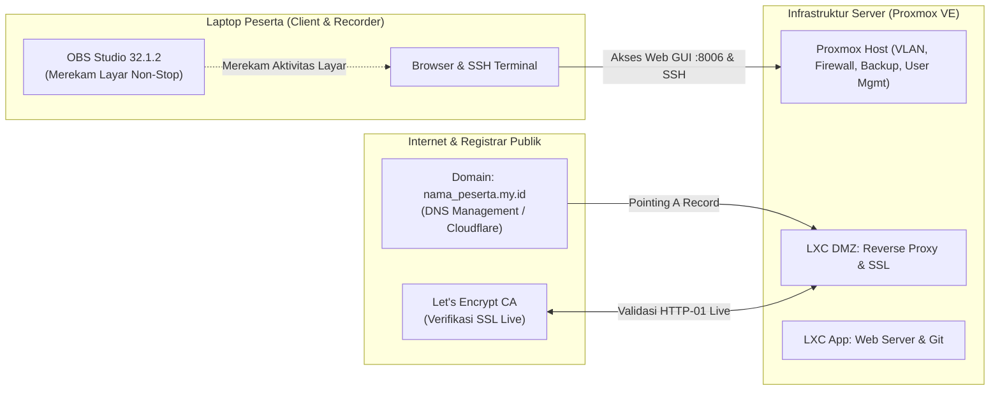

# Panduan & Bedah Lengkap Lomba Atswa NeSA Skill Competition
**Platform Resmi**: [nesa.atswa.co.id](https://nesa.atswa.co.id)  
**Penyelenggara**: CV. Atswa Indonesia (Kompetisi Keahlian IT Network & System Administration Tingkat Nasional)

---

## 1. Bedah Perlengkapan Peserta: Kenapa Benda-Benda Ini Diwajibkan?

Banyak peserta bingung mengapa panitia NeSA Atswa meminta perlengkapan spesifik seperti di bawah ini. Berikut fungsi nyata dan strategi di balik setiap perlengkapan:



---

### A. Laptop (Minimal 2 Core, 2 GB RAM, 128 GB Storage, Wi-Fi & Ethernet)
- **Fungsinya di Lomba**:
  Laptop Anda bertindak sebagai **Management Console & Workstation Peserta**.
  - **Port Ethernet (Kabel LAN)**: Dipakai untuk koneksi super stabil ke jaringan lokal juri/server Proxmox (kecepatan gigabit tanpa gangguan interferensi).
  - **Wireless (Wi-Fi)**: Sering digunakan sebagai jalur akses ke internet luar (untuk mengurus DNS domain publik dan download package/SSL).
- **Strategi Optimasi Spek Minim**:
  Jika laptop Anda pas-pasan (RAM 2–4 GB), jangan buka terlalu banyak tab browser! Gunakan browser ringan dan terminal SSH (seperti PuTTY atau Windows Terminal) agar laptop tidak lag saat merekam layar.

---

### B. OBS Studio 32.1.2 Wajib Terinstall
- **Kenapa Juri Mewajibkan OBS Studio?**
  1. **Pengawasan Ketat (Anti-Cheating / Proctoring)**:  
     Di kompetisi modern seperti NeSA Atswa, seluruh aktivitas layar peserta direkam dari detik pertama lomba dimulai sampai waktu habis.
  2. **Bukti Saat Masa Sanggah**:  
     Jika saat penilaian ada service yang dinilai salah oleh juri padahal menurut Anda sudah benar, file rekaman OBS ini menjadi **alat bukti sah** untuk mengajukan sanggahan (protes resmi) ke dewan juri.
  3. **Verifikasi Originalitas**:  
     Juri bisa memeriksa apakah Anda mengetik sendiri, atau ada transfer file mencurigakan dari luar.
- **Trik Setting OBS agar Laptop Tidak Berat (Nge-lag)**:
  - *Resolution*: Set Canvas & Output ke **1280x720 (720p)**. Jangan pakai 1080p jika laptop spek rendah.
  - *FPS*: Cukup **30 FPS** (sudah sangat jelas membaca teks terminal).
  - *Video Bitrate*: **1500 kbps - 2000 kbps** (kualitas teks tajam, tapi ukuran file hemat dan CPU enteng).
  - *Encoder*: Pilih **Hardware (QSV / NVENC / AMD)** jika ada, atau **x264 dengan CPU Preset: `ultrafast`**.

---

### C. Domain `nama_peserta.my.id` (Berlangganan Mandiri)
- **Ini Kunci Terbesar Lomba NeSA Atswa!**
  Pada lomba LKS biasa, domain sering kali hanya domain palsu lokal (seperti `lomba.lan` atau `itnsa.local`).  
  Namun di NeSA Atswa, Anda **diwajibkan membeli domain resmi TLD `.my.id` di internet publik**.
- **Apa Artinya?**
  1. **Integrasi DNS Publik Nyata**: Anda harus bisa menyetel *DNS Record* (A Record, CNAME, NS Record) di dashboard registrar (seperti Cloudflare, Niagahoster, Domainesia, dsb.).
  2. **SSL Let's Encrypt BUKAN Simulasi!**:  
     Karena memakai domain publik asli yang aktif di internet, pengujian SSL Let's Encrypt akan **benar-benar menghubungi server Let's Encrypt secara live**.
  3. **Akses Publik**: Juri bisa membuka website hasil kerja Anda dari laptop mereka langsung lewat internet dengan mengetik `https://subdomain.nama_peserta.my.id`.

---

## 2. Bedah Materi Lomba & Penerapannya di NeSA Atswa

Berikut penjelasan bahasa santai mengapa materi-materi ini diujikan dan bagaimana mereka saling terhubung:

### 1. Linux Dasar & Ubuntu 24 LTS
- **Ibaratnya**: Bahasa percakapan dasar yang dipakai di seluruh server.
- **Fungsinya di Lomba**:
  - Ubuntu 24.04 LTS dipasang di dalam container LXC Proxmox.
  - Anda harus terbiasa dengan CLI (tanpa mouse): berpindah folder, edit teks (`nano` / `vim`), manajemen user, hak izin file (`chmod`, `chown`).
  - **Netplan v2**: Mengatur IP address statis, gateway, dan DNS di file `/etc/netplan/*.yaml`.
  - **Systemd**: Mengatur agar aplikasi otomatis jalan saat boot (`systemctl enable --now <service>`).

### 2. Domain (DNS)
- **Ibaratnya**: Buku kontak telepon internet.
- **Fungsinya di Lomba**:
  - Mengarahkan `nama_peserta.my.id` dan sub-domainnya (misal `app.nama_peserta.my.id` atau `portal.nama_peserta.my.id`) ke IP publik server atau IP lab juri.
  - Mengonfigurasi BIND9 di server lokal untuk menangani resolusi nama di dalam jaringan internal.

### 3. Git Dasar
- **Ibaratnya**: Kurir pengantar file aplikasi web.
- **Fungsinya di Lomba**:
  - Panitia NeSA Atswa biasanya menyediakan link repository Git berisi source code website/aplikasi lomba.
  - Anda diminta melakukan `git clone` dari branch yang ditentukan (misal branch `production`).
  - Menyiapkan izin folder agar file yang ditarik dari Git bisa dibaca oleh web server `www-data`.

### 4. Web Server (Nginx / Apache)
- **Ibaratnya**: Koki dapur yang menyiapkan file website saat diminta browser.
- **Fungsinya di Lomba**:
  - Mengatur VirtualHost (Server Block) untuk menyajikan aplikasi web.
  - Mengintegrasikan web server dengan backend (seperti PHP-FPM) agar web dinamis bisa berjalan.
  - Mengatur halaman error kustom (404, 502) dan mengamankan file sensitif agar tidak bisa diintip orang luar.

### 5. Reverse Proxy
- **Ibaratnya**: Resepsionis di lobi gedung kantor. Tamu luar kota tidak boleh langsung masuk dapur/ruang brankas.
- **Fungsinya di Lomba**:
  - Menerima semua kunjungan tamu dari domain `nama_peserta.my.id` di baris terdepan (DMZ).
  - Mengalihkan (*forward*) kunjungan tersebut ke Web Server yang bersembunyi di jaringan privat belakang.
  - Menitipkan header penting (`X-Real-IP`, `X-Forwarded-For`, `X-Forwarded-Proto`) agar server belakang tetap tahu IP asli pengunjung.

### 6. SSL Let's Encrypt (Live Publik!)
- **Ibaratnya**: Gembok segel brankas resmi (HTTPS).
- **Fungsinya di Lomba**:
  - Memasang **Certbot** untuk menerbitkan sertifikat SSL resmi gratis dari Let's Encrypt untuk domain `nama_peserta.my.id`.
  - Memaksa pengunjung yang mengetik `http://` agar otomatis dibelokkan (*redirect 301*) ke `https://`.
  - Menghilangkan peringatan merah *"Not Secure"* di browser juri sehingga muncul logo gembok aman.

### 7. Proxmox VE (LXC, Firewall, User Management, Backup, VLAN)
- **Ibaratnya**: Gedung apartemen tempat Anda mendirikan banyak server sekaligus.
  - **LXC**: Membuat server container yang super enteng (boot cuma 3 detik, hemat RAM) untuk wadah Nginx, Web, dan DNS.
  - **VLAN**: Membuat sekat pemisah jaringan (misal: VLAN 10 untuk Reverse Proxy publik, VLAN 20 untuk Web Server internal yang tidak boleh disentuh langsung dari luar).
  - **Firewall**: Memasang satpam penjaga gerbang. Menolak semua port asing (*DROP*), hanya membuka port 80 (HTTP), 443 (HTTPS), dan port manajemen yang diizinkan.
  - **User Management**: Membuatkan akun khusus untuk juri (misal `juri@pve` dengan izin `PVEAuditor` agar juri bisa memeriksa tanpa merusak sistem).
  - **Backup (VZDump)**: Menyetel jadwal backup otomatis harian dengan aturan pembersihan (*prune retention*) agar harddisk tidak kepenuhan.

---

## 3. Prediksi Alur Skenario Soal NeSA Atswa

Berdasarkan syarat perlengkapan dan materinya, berikut gambaran skenario nyata yang paling mungkin terjadi di hari lomba:

```
[Laptop Juri / Penguji]
         │
         ▼ 1. Membuka https://app.nama_peserta.my.id di browser
[Cloudflare / DNS Publik] 
         │ (Mengubah domain .my.id menjadi IP server peserta)
         ▼ 
[PROXMOX HOST PESERTA]
   ├── [FIREWALL]: Memeriksa paket port 443 -> Diizinkan masuk!
   │
   ├── [VLAN 10 - DMZ]: 
   │     LXC Reverse Proxy (Nginx + SSL Let's Encrypt Valid)
   │     - Menghentikan enkripsi HTTPS
   │     - Mengoper paket lewat jalur VLAN internal
   │
   └── [VLAN 20 - INTERNAL]:
         LXC Web Server (Nginx + PHP)
         - Source code ditarik dari Git panitia
         - Melayani data web kembali ke pengunjung
```

---

## 4. Checklist Persiapan Emas Sebelum Hari H

1. **Domain `.my.id` Siap Pakai**:
   - Pastikan domain sudah aktif dan akun DNS Management (misal **Cloudflare** atau portal registrar) sudah bisa Anda akses dengan lancar.
   - Pahami cara cepat membuat **A Record** (mengarahkan domain/subdomain ke IP server) dan mengatur TTL ke *Auto* / *1 menit*.
2. **Uji Coba OBS Studio di Rumah**:
   - Lakukan rekaman tes selama 1–2 jam sambil membuka terminal dan browser.
   - Pastikan laptop tidak panas berlebih (*overheating*) dan file rekaman tersimpan rapi tanpa corrupt.
3. **Pahami Urutan Eksekusi**:
   - Jangan sentuh SSL sebelum Domain & DNS selesai mengarah ke IP yang benar!
   - Jangan nyalakan Firewall sebelum port 80, 443, dan 8006/22 di-whitelist!
   - **Simulasi Reboot**: Selalu luangkan waktu 15 menit sebelum lomba selesai untuk me-reboot server dan memastikan semua service menyala otomatis.
