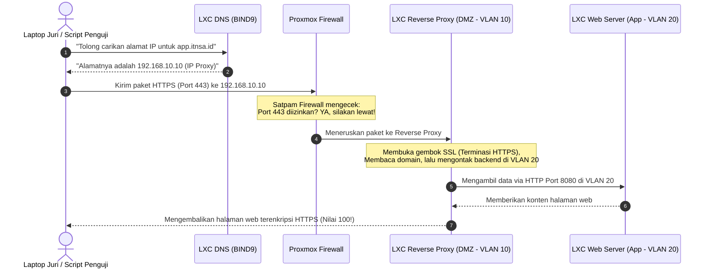

# Panduan Kisi-Kisi Lomba ITNSA (Versi Mudah Dipahami & Bahasa Santai)

> 💡 **Prinsip Utama Lomba ITNSA**:  
> Di lomba ITNSA (LKS / WorldSkills), **soal dan angka (IP, nama domain, port) akan selalu berubah-ubah di setiap lomba**.  
> Jangan menghafal baris perintah! Pahami **"Benda ini fungsinya apa?"**, **"Kenapa juri menyuruh pasang ini?"**, dan **"Gimana cara juri ngecek kalau kerjaan kita bener?"**.

---

## Peta Cepat: Analogi Dunia Nyata

Biar langsung kebayang, bayangkan seluruh sistem yang kita bangun di lomba itu seperti **Satu Kompleks Perkantoran Modern**:

| Topik | Analogi Dunia Nyata | Fungsi Utamanya |
|---|---|---|
| **Proxmox VE** | **Gedung Apartemen / Perkantoran** | Tempat mendirikan banyak ruangan/server di dalam 1 komputer fisik. |
| **LXC** | **Kamar Kos / Bilik Kantor** | Ruangan server yang hemat tempat, ringan, dan cepat dibangun. |
| **VLAN** | **Lorong Khusus / Lift Ber-Kartu Akses** | Jalur khusus agar tamu umum tidak bisa nyasar ke ruang brankas rahasia. |
| **Firewall** | **Pos Satpam & Pintu Gerbang** | Menyaring siapa yang boleh masuk dan siapa yang langsung ditendang keluar. |
| **User Management** | **Kartu Tanda Pengenal (ID Card)** | Menentukan siapa bos (Admin) dan siapa yang cuma boleh lihat-lihat (Auditor/Juri). |
| **Backup** | **Kotak Brankas Penyelamat** | Kloningan cadangan jika sewaktu-waktu ruangan hancur/rusak. |
| **Linux & Ubuntu 24** | **Sistem Operasi / Fondasi Lantai** | Bahasa dasar yang dipakai setiap komputer di dalam ruangan. |
| **Domain (DNS)** | **Buku Telepon Kontak HP** | Mengubah nama gampang (`web.id`) jadi nomor IP rumit (`192.168.1.10`). |
| **Git Dasar** | **Kurir Mesin Waktu** | Pengantar file kodingan aplikasi web dari gudang ke server. |
| **Web Server** | **Dapur & Meja Kasir** | Yang menyiapkan dan menyajikan halaman web saat diminta pengunjung. |
| **Reverse Proxy** | **Resepsionis di Lobi Depan** | Tamu tidak boleh langsung masuk dapur, resepsionis yang mengambilkan makanan dari dapur untuk tamu. |
| **SSL Let's Encrypt** | **Surat Bersegel Resmi / Gembok Pengaman** | Menjamin paket data dibungkus rapi dan tidak bisa diintip orang di jalan. |

---

## 1. Linux Dasar & Ubuntu 24.04 LTS

### 🏢 Ibaratnya Apa?
Ibarat **pondasi dan aturan tata tertib gedung**. Semua server yang akan kita buat berjalan di atas sistem operasi Linux.

### 🧠 Sebenarnya Ini Apa & Cara Kerjanya?
Linux adalah sistem operasi berbasis teks (Command Line / CLI) yang menjadi standar server dunia. Ubuntu 24.04 LTS adalah versi jangka panjang terbaru.
Ada 4 hal dasar yang paling penting dipahami:
1. **User & Hak Akses (Permission)**:  
   Linux sangat ketat soal hak milik. File web harus bisa dibaca oleh sistem web (`www-data`), tapi file sensitif seperti kunci enkripsi cuma boleh dibaca oleh `root`.
2. **Service / Systemd**:  
   Program di server berjalan di latar belakang (*background*). Perintah `systemctl start` hanya menyalakan sekarang (kalau PC dimatikan, aplikasinya mati lagi). Perintah `systemctl enable` menyuruh komputer: *"Tiap kali kamu menyala, otomatis langsung jalankan aplikasi ini!"*.
3. **Netplan (Pengatur IP di Ubuntu)**:  
   File YAML di `/etc/netplan/` adalah tempat menentukan alamat IP server, gerbang keluar (*gateway*), dan DNS.
4. **Perubahan di Ubuntu 24 LTS**:  
   Secara default, Ubuntu 24 punya fitur internal bernama `systemd-resolved` yang otomatis memegang Port 53 (port DNS).

### 🎯 Kenapa Ada di Soal Lomba?
- Juri ingin melihat apakah Anda bisa mengoperasikan server tanpa bantuan tampilan mouse/GUI.
- **Uji Persistensi**: Juri akan sengaja me-reboot komputer Anda di akhir lomba. Kalau setelah nyala IP Anda hilang atau servicenya mati, nilai Anda langsung 0.

### ⚠️ Jebakan Maut Peserta Pemula
- **Salah Menekan Tombol TAB di Netplan**: Format file YAML **anti-TAB**. Kalau Anda menekan tombol Tab di keyboard (bukan spasi), network akan langsung rusak dan server tidak bisa konek ke mana pun pasca-reboot.
- **Port 53 Tabrakan**: Saat menginstall DNS server BIND9, sering error `Address already in use`. Penyebabnya adalah `systemd-resolved` bawaan Ubuntu 24 yang belum dimatikan.

---

## 2. Domain (DNS Server - BIND9)

### 🏢 Ibaratnya Apa?
Ibarat **buku kontak di HP Anda**.  
Otak manusia tidak bisa menghafal nomor telepon semua temannya (`0812-3456-7890`), kita lebih gampang mengingat nama ("Budi"). DNS bertugas mengubah nama gampang (`app.itnsa.id`) menjadi nomor alamat IP (`192.168.10.10`).

### 🧠 Sebenarnya Ini Apa & Cara Kerjanya?
DNS bekerja dengan konsep zona dan catatan (*records*):
- **A Record**: Menghubungkan Nama $\rightarrow$ Alamat IPv4 (Contoh: `web.itnsa.id` $\rightarrow$ `192.168.10.10`).
- **PTR Record (Reverse DNS)**: Kebalikannya, mengubah IP $\rightarrow$ Nama (biasanya dicek untuk keamanan server email dan audit).
- **CNAME**: Nama panggilan / alias (Contoh: `portal.itnsa.id` ikuti saja alamatnya `web.itnsa.id`).
- **Forwarder**: *"Kalau ada klien nanya domain internet yang saya nggak tahu (misal `google.com`), oper pertanyaan itu ke server 8.8.8.8"*.

### 🎯 Kenapa Ada di Soal Lomba?
DNS adalah **tulang punggung utama**. Di awal lomba, Anda wajib membangun DNS dulu.  
Kenapa? Karena script penguji otomatis milik juri tidak akan mengakses web Anda lewat IP, tapi lewat nama domain (misal `curl https://app.itnsa.id`). Kalau DNS Anda mati, pengujian Web Server, Proxy, dan SSL akan **otomatis gagal total** (efek domino).

### ⚠️ Jebakan Maut Peserta Pemula
- **Lupa Titik di Akhir (`.`)**:  
  Di file konfigurasi BIND9, kalau Anda menulis `ns1.itnsa.id` tanpa titik di belakang, sistem akan otomatis membaca itu sebagai `ns1.itnsa.id.itnsa.id`. Selalu akhiri nama FQDN dengan titik: `ns1.itnsa.id.`.
- **Lupa Menaikkan Serial Number**:  
  Kalau mengubah isi IP di DNS tapi lupa menaikkan angka `Serial`, perubahan Anda tidak akan dibaca oleh sistem.

---

## 3. Git Dasar

### 🏢 Ibaratnya Apa?
Ibarat **mesin waktu sekaligus kurir pengantar barang**.  
Git mencatat semua riwayat perubahan file dan bertugas mengantarkan file kodingan dari repository pusat (seperti GitHub/GitLab lokal) ke dalam folder server.

### 🧠 Sebenarnya Ini Apa & Cara Kerjanya?
- **Clone / Pull**: Mengambil salinan kode dari server pusat ke komputer kita.
- **Branch**: Cabang pengerjaan. Misalnya branch `main` untuk kode uji coba, dan branch `production` untuk kode yang sudah siap dipakai di publik.
- **Git Hook (`post-receive`)**: Robot pemicu otomatis. Begitu ada perintah *"push kode baru"*, robot ini langsung menyalin file baru itu ke folder `/var/www/html` tanpa perlu admin mengutak-atik server lagi.

### 🎯 Kenapa Ada di Soal Lomba?
Di lomba modern, juri tidak lagi membagikan file website lewat flashdisk. Juri akan memberikan link repository Git. Anda disuruh:
1. Menarik (*clone*) kode web dari branch tertentu (misal branch `release-v1`).
2. Menyiapkan sistem agar ketika juri melakukan `git push` bahan ujian baru, website langsung terupdate otomatis.

### ⚠️ Jebakan Maut Peserta Pemula
- **File `.git` Ketinggalan di Folder Publik**:  
  Kalau Anda meng-clone repo langsung ke `/var/www/html`, folder `.git` rahasia akan bisa diakses orang lain lewat browser (`http://web.id/.git`). Juri keamanan akan mengurangi nilai Anda karena ini celah kebocoran data.
- **Salah User Pemilik**:  
  Jika meng-clone menggunakan akun `root`, aplikasi web (PHP) tidak akan bisa menulis data karena pemilik filenya adalah `root`, bukan `www-data`.

---

## 4. Web Server (Nginx / Apache)

### 🏢 Ibaratnya Apa?
Ibarat **koki dapur di restoran**.  
Ketika pelanggan memesan menu (mengetik alamat web di browser), koki web server yang mengambilkan file HTML, gambar, atau memasak skrip PHP, lalu menyajikannya ke piring browser pengunjung.

### 🧠 Sebenarnya Ini Apa & Cara Kerjanya?
- **Virtual Host / Server Block**:  
  Satu komputer server bisa menampung 10 website sekaligus dengan nama berbeda (`sekolah.id`, `toko.id`). Web server tahu harus menyajikan web yang mana dengan membaca **nama tujuan** yang dikirimkan oleh browser.
- **Pemisahan Statis vs Dinamis**:  
  File gambar/HTML disajikan langsung oleh Nginx (cepat dan ringan). File program rumit seperti PHP diserahkan ke program terpisah bernama **PHP-FPM**.
- **Logika Lokasi & Akses**:  
  Mengatur folder mana yang boleh dibuka umum dan folder mana yang ditolak (misal: mematikan intip folder / *autoindex*).

### 🎯 Kenapa Ada di Soal Lomba?
Untuk menguji kemampuan Anda menyajikan konten web yang rapi, cepat, dan aman. Juri biasanya menguji:
- Apakah nama websitenya sesuai dengan instruksi?
- Apakah halaman 404 Not Found sudah dikustomisasi?
- Apakah script PHP bisa berjalan normal dan konek ke database?

### ⚠️ Jebakan Maut Peserta Pemula
- **Salah Default Server**:  
  Saat ada 2 website di 1 server, jika pengaturannya salah, pengunjung yang membuka `website-A.id` malah nyasar melihat konten `website-B.id`.
- **Izin Folder Rusak**:  
  File web ditaruh di folder yang hak izinnya salah, sehingga browser menampilkan pesan error `403 Forbidden`.

---

## 5. Reverse Proxy

### 🏢 Ibaratnya Apa?
Ibarat **resepsionis di lobi gedung kantor**.  
Tamu dari luar kota **tidak boleh langsung masuk ke ruang brankas atau dapur kantor**. Tamu hanya boleh bicara dengan resepsionis di lobi. Resepsionis yang akan berjalan ke belakang mengambilkan barang, lalu menyerahkannya ke tamu.

```
[Pengunjung Luar]
       │
       ▼ (Bicara hanya ke Resepsionis)
 [REVERSE PROXY di Lobi / DMZ]
       │
       ▼ (Mengambil data di ruang privat)
[Backend Server di Ruang Belakang]
```

### 🧠 Sebenarnya Ini Apa & Cara Kerjanya?
Reverse proxy (biasanya memakai Nginx) dipasang di baris paling depan (jaringan publik/DMZ). Server aplikasi asli disembunyikan di jaringan belakang (privat).
Tugas penting Reverse Proxy:
1. **Penyambung Lidah (Forwarding)**: Menerima request di port 80/443, lalu meneruskannya ke port internal (misal port 8080 di server belakang).
2. **Titip Catatan Identitas (Headers)**:  
   Karena server belakang hanya melihat koneksi dari si Resepsionis, proxy wajib menyisipkan catatan kecil: *"Pak Backend, ini yang minta aslinya pengunjung dengan IP 202.10.x.x ya!"* (Header `X-Real-IP` dan `X-Forwarded-For`).
3. **Pembagi Beban (Load Balancing)**:  
   Kalau pengunjung membludak, proxy bisa membagi tugas: request 1 dikirim ke Backend-1, request 2 dikirim ke Backend-2.

### 🎯 Kenapa Ada di Soal Lomba?
Di dunia industri, menaruh server aplikasi dan database langsung ke internet adalah dosa besar keamanan. Juri ingin melihat apakah Anda bisa memisahkan zona publik dan zona privat menggunakan Reverse Proxy.

### ⚠️ Jebakan Maut Peserta Pemula
- **Redirect Loop (Muter-Muter Terus)**:  
  Proxy mengontak backend lewat HTTP, tapi backend merasa *"Hei, harusnya lewat HTTPS!"*, lalu backend melempar redirect balik ke proxy. Website akhirnya gagal dibuka dan browser menampilkan pesan *Too many redirects*.
- **Lupa Forward IP**:  
  Jika lupa memasang header `proxy_set_header X-Real-IP`, catatan log di server belakang akan mencatat semua pengunjung berasal dari IP proxy itu sendiri. Ini membuat poin audit Anda dipotong juri.

---

## 6. SSL Let's Encrypt & Certbot

### 🏢 Ibaratnya Apa?
Ibarat **amplop bersegel lilin resmi atau gembok brankas**.  
Kalau membuka web lewat `HTTP` biasa, ibarat mengirim surat lewat kartu pos: semua orang di jalan (hacker/penyedia wifi) bisa membaca pesan Anda. Kalau lewat `HTTPS`, surat dimasukkan ke dalam amplop baja anti-tembus pandang yang hanya bisa dibuka oleh si pemilik kunci.

### 🧠 Sebenarnya Ini Apa & Cara Kerjanya?
- **Sertifikat SSL/TLS**: KTP digital resmi yang membuktikan bahwa website Anda asli dan aman.
- **Let's Encrypt**: Lembaga internasional yang membagikan sertifikat SSL gratis secara otomatis.
- **Certbot**: Robot kecil yang kita pasang di server untuk menghubungi Let's Encrypt dan meminta sertifikat secara otomatis.
- **Tantangan Validasi (HTTP-01 Challenge)**:  
  Untuk membuktikan Anda benar-benar pemilik domain, robot Let's Encrypt akan mengetes: *"Tolong taruh file rahasia di website kamu di folder `/.well-known/acme-challenge/`. Kalau saya bisa download file itu lewat internet, berarti web itu resmi milikmu!"*.

### 🎯 Kenapa Ada di Soal Lomba?
Juri ingin memastikan Anda bisa menerapkan keamanan web modern:
1. Web wajib berjalan di HTTPS (Port 443).
2. Pengunjung yang mengetik `http://` otomatis dipaksa pindah (*redirect*) ke `https://`.
3. **Kondisi Lab Offline**: Jika saat lomba tidak ada internet luar, juri biasanya menyediakan server sertifikat tiruan di jaringan lokal (Root CA lokal). Anda harus bisa menyambungkan Certbot ke server lokal juri atau mengimpor sertifikat lokal ke sistem.

### ⚠️ Jebakan Maut Peserta Pemula
- **Path Challenge Tertutup Proxy**:  
  Saat Certbot mencoba menaruh file pembuktian, file itu malah dialihkan oleh Reverse Proxy ke backend yang tidak tahu apa-apa, sehingga verifikasi gagal.
- **Sertifikat Tidak Lengkap (Broken Chain)**:  
  Salah memilih file sertifikat di Nginx. Mengisi dengan `cert.pem` akan membuat browser memunculkan peringatan merah bahaya; Anda wajib menggunakan `fullchain.pem`.

---

## 7. Proxmox VE (LXC, Firewall, User Management, Backup, VLAN)

### 🏢 Ibaratnya Apa?
Ibarat **Gedung Perkantoran Canggih bertingkat banyak**.  
Alih-alih menyuruh Anda membeli 5 komputer fisik yang boros tempat dan listrik, juri memberikan 1 komputer server fisik besar yang di dalamnya dipasang Proxmox untuk membuat miniatur data center.

---

### A. LXC (Linux Containers)
- **Ibaratnya**: **Kamar Kos Bersekat Partisi**.  
  Berbeda dari Virtual Machine (VM) penuh yang ibarat membangun rumah mandiri lengkap dari nol (berat, makan RAM 2–4 GB), LXC adalah kamar kos ringan yang menumpang pada satu sistem kernel Proxmox.
- **Kelebihan di Lomba**: Membuka container LXC cuma butuh 3 detik dan hanya makan RAM 60 MB. Ini sangat membantu agar laptop/PC lomba Anda tidak lambat atau nge-hang saat menjalankan banyak server sekaligus.

### B. VLAN (Virtual LAN)
- **Ibaratnya**: **Lorong Tertutup dengan Pintu Bersekat Khusus**.  
  Semua server tercolok ke switch yang sama (`vmbr0`), tapi dengan VLAN kita membagi kabel itu menjadi jalur-jalur rahasia:
  - *VLAN 10 (Lantai Depan / DMZ)*: Untuk Resepsionis & DNS.
  - *VLAN 20 (Lantai Belakang / App)*: Untuk Koki Web & Database.
  - *VLAN 99 (Ruang Kontrol)*: Khusus untuk Admin mengelola Proxmox.  
  Orang di VLAN 10 tidak akan bisa langsung menyelonong masuk ke VLAN 20 tanpa izin satpam.

### C. Firewall
- **Ibaratnya**: **Satpam Penjaga Palang Pintu**.  
  Aturan dasar keamanan: **Tolak Semua Tamu Asing, Kecuali yang Membawa Undangan** (*Policy: DROP*).
  - Pintu 80 (HTTP) dan 443 (HTTPS) dibuka untuk umum.
  - Pintu 22 (SSH) dan 8006 (Proxmox GUI) hanya boleh dimasuki oleh komputer laptop juri/admin.
- **Jebakan Fatal**: Menyalakan firewall dengan aturan tolak (*DROP*) sebelum mengizinkan IP sendiri. Hasilnya: **Anda langsung terkunci di luar server sendiri!**

### D. User Management & Hak Akses
- **Ibaratnya**: **Kartu ID Card Karyawan vs Tamu**.  
  Juri tidak boleh memakai akun `root` milik Anda. Juri akan menyuruh Anda membuat akun khusus (misal `juri@pve`):
  - Diberi peran **PVEAuditor**: Juri cuma boleh mengecek dan melihat-lihat status container.
  - Tombol hapus, stop, dan edit terkunci agar aman.

### E. Backup (VZDump)
- **Ibaratnya**: **Mesin Kloning & Brankas Cadangan**.  
  Mengambil foto cetak biru seluruh isi server secara berkala.
  - Kalau suatu hari ada hacker merusak server atau Anda salah ketik perintah fatal, tinggal klik tombol *Restore*, dan server langsung pulih seperti sedia kala dalam 1 menit.
  - **Pruning (Pembersihan)**: Menjaga brankas agar tidak meledak penuh dengan menyetel aturan: *"Simpan hanya 3 file backup terbaru, hapus otomatis backup lama"*.

---

## 8. Alur Integrasi: Bagaimana Semuanya Bekerja Bersama?

Biar semakin paham, mari kita lihat apa yang terjadi saat Juri menguji sistem Anda:



---

## 9. Tebakan Skenario Soal Lomba & Cara Membacanya

Ketika Anda menerima kertas soal lomba setebal 10 halaman, jangan pusing! Pada dasarnya, soal lomba hanya menceritakan satu cerita sederhana berikut:

> **"Skenario Cerita Soal LKS"**:  
> Perusahaan bernama *ITNSA Corp* ingin membuat sistem web portal yang aman.  
> 1. Siapkan 1 mesin Proxmox dengan 2 VLAN (VLAN 10 untuk layanan depan, VLAN 20 untuk aplikasi internal).  
> 2. Buat container ringan (LXC) untuk masing-masing layanan.  
> 3. Buatkan nama domain kantor menggunakan BIND9 agar web bisa dibuka lewat nama, bukan angka IP.  
> 4. Taruh Web Server di VLAN 20 yang kodenya ditarik langsung dari Git.  
> 5. Pasang Reverse Proxy di VLAN 10 agar pengunjung luar tidak bisa menyentuh server web secara langsung.  
> 6. Pasang gembok sertifikat SSL agar web berjalan di `https://` dan amankan dengan Firewall.  
> 7. Buatkan akun pengawas untuk Juri, dan jadwalkan backup otomatis setiap malam.  
> 8. **Tes Terakhir**: Server akan dimatikan (reboot). Semua fungsi di atas harus langsung menyala kembali secara otomatis!

---

## 10. Tiga Prinsip Anti-Panik Saat Lomba

1. **Prinsip Mengurutkan Pekerjaan**:  
   Kerjakan dari **bawah ke atas**:  
   $\text{VLAN \& Bridge} \rightarrow \text{LXC Container} \rightarrow \text{IP Netplan} \rightarrow \text{DNS} \rightarrow \text{Web \& Git} \rightarrow \text{Proxy \& SSL} \rightarrow \text{Firewall}$.  
   *(Jangan pernah memasang SSL kalau DNS Anda belum bisa menjawab query domain!)*
2. **Prinsip Jangan Kunci Diri Sendiri**:  
   Konfigurasi Firewall selalu dipasang di **tahap paling akhir**, setelah semua web dan service terbukti berjalan lancar.
3. **Simulasi Reboot 20 Menit Sebelum Selesai**:  
   Jangan gunakan detik-detik terakhir untuk mengutak-atik hal baru. Luangkan 20 menit untuk mematikan dan menyalakan ulang komputer utama. Pastikan tidak ada yang lupa di-`systemctl enable`!
