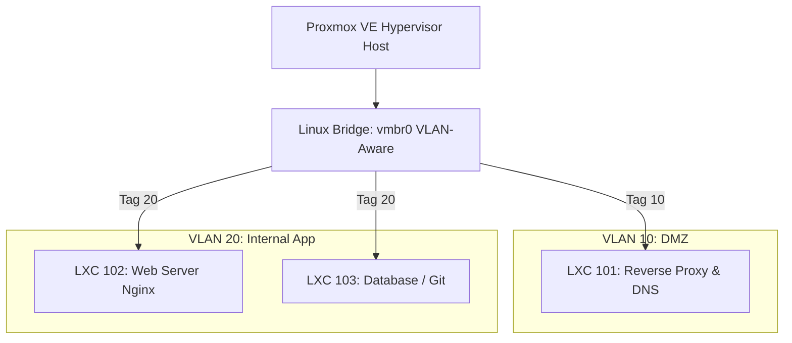

# Panduan Komprehensif Kisi-Kisi Lomba ITNSA (IT Network System Administration)

Dokumen ini disusun khusus sebagai referensi belajar intensif menghadapi lomba **ITNSA** (seperti LKS SMK, WorldSkills, atau kompetisi administrasi server). Materi mencakup landasan teori, implementasi fungsi riil di lomba, contoh konfigurasi langsung (production/competition-ready), dan prediksi skenario soal terpadu di bagian akhir.

---

## Daftar Isi
1. [Karakteristik Penilaian Lomba ITNSA](#karakteristik-penilaian-lomba-itnsa)
2. [Topik 1: Linux Dasar & Ubuntu 24.04 LTS](#topik-1-linux-dasar--ubuntu-2404-lts)
3. [Topik 2: Domain Name System (DNS)](#topik-2-domain-name-system-dns)
4. [Topik 3: Git Dasar & Deployment](#topik-3-git-dasar--deployment)
5. [Topik 4: Web Server (Nginx / Apache)](#topik-4-web-server-nginx--apache)
6. [Topik 5: Reverse Proxy](#topik-5-reverse-proxy)
7. [Topik 6: SSL / TLS (Let's Encrypt & Certbot)](#topik-6-ssl--tls-lets-encrypt--certbot)
8. [Topik 7: Proxmox VE (LXC, Firewall, User Management, Backup, VLAN)](#topik-7-proxmox-ve-lxc-firewall-user-management-backup-vlan)
9. [Simulasi & Prediksi Skenario Soal Lomba ITNSA](#simulasi--prediksi-skenario-soal-lomba-itnsa)
10. [Tips & Trik Juara LKS / ITNSA](#tips--trik-juara-lks--itnsa)

---

## Karakteristik Penilaian Lomba ITNSA

Kompetisi IT Network System Administration menggunakan standar **WorldSkills Competition (WSC)**:
- **Automated Grading (Scripting)**: Juri menguji ketersediaan port, validitas SSL, resolving DNS, dan respon HTTP menggunakan script otomatis (seperti Ansible, Bash tester, atau Testinfra).
- **Service Persistence**: Server akan di-*reboot* sebelum dinilai. Jika service mati setelah reboot, nilainya **0**.
- **Security & Least Privilege**: Akses root langsung via SSH sering kali dilarang; user dan permission harus presisi.
- **Speed & Precision**: Waktu modul terbatas (biasanya 2.5 - 3 jam per modul). Efisiensi CLI sangat menentukan.

---

## Topik 1: Linux Dasar & Ubuntu 24.04 LTS

### 1. Penjelasan & Fungsi di Lomba
Ubuntu 24.04 LTS (Noble Numbat) adalah sistem operasi server modern berbasis kernel Linux 6.8 yang menggunakan `systemd` v255 dan Netplan versi terbaru. 
- **Di Lomba Digunakan Untuk**:
  - Base OS pada VM atau LXC Container.
  - Manajemen user/grup dengan batasan privilege (sudoers).
  - Konfigurasi antarmuka jaringan statis, gateway, dan routing via Netplan.
  - Troubleshooting service menggunakan `journalctl` dan `systemctl`.

### 2. Poin Kritis Ubuntu 24.04 LTS
- **Netplan Default**: Konfigurasi network sepenuhnya berada di `/etc/netplan/*.yaml` dengan renderer `networkd`.
- **Systemd-resolved**: Ubuntu 24.04 secara default mengaktifkan stub resolver lokal di `127.0.0.53:53`. Saat mengonfigurasi DNS server lokal (BIND9), Anda harus mematikan atau mengalihkan port 53 stub resolver.

### 3. Contoh Konfigurasi Praktis

#### A. Konfigurasi Netplan IP Statis (`/etc/netplan/01-netcfg.yaml`)
```yaml
network:
  version: 2
  renderer: networkd
  ethernets:
    eth0:
      dhcp4: false
      addresses:
        - 192.168.10.10/24
      routes:
        - to: default
          via: 192.168.10.1
      nameservers:
        addresses:
          - 192.168.10.5
          - 8.8.8.8
        search:
          - itnsa.lan
```
*Terapkan konfigurasi:*
```bash
sudo netplan generate
sudo netplan apply
```

#### B. User Management & Sudoers Hardening
```bash
# Membuat user kompetisi/grader tanpa password prompt saat sudo
sudo adduser --gecos "" itadmin
sudo usermod -aG sudo itadmin

# Memberikan akses spesifik via /etc/sudoers.d/itadmin
echo "itadmin ALL=(ALL) NOPASSWD: /usr/bin/systemctl restart nginx" | sudo tee /etc/sudoers.d/itadmin
sudo chmod 0440 /etc/sudoers.d/itadmin
```

#### C. SSH Hardening (`/etc/ssh/sshd_config.d/hardening.conf`)
```ini
Port 2222
PermitRootLogin no
PasswordAuthentication yes
MaxAuthTries 3
```
```bash
sudo systemctl restart ssh
```

---

## Topik 2: Domain Name System (DNS)

### 1. Penjelasan & Fungsi di Lomba
DNS bertugas menerjemahkan *Fully Qualified Domain Name* (FQDN) menjadi alamat IP (Forward Lookup) dan sebaliknya (Reverse Lookup).
- **Di Lomba Digunakan Untuk**:
  - Menyediakan nama domain internal (misal: `*.itnsa.id`, `ns1.itnsa.id`, `app.itnsa.id`).
  - Menghubungkan client, reverse proxy, dan backend server.
  - Sering kali menjadi **Single Point of Failure**; jika DNS salah, otomatis pengujian web service, SSL, dan remote git akan gagal.
  - Software standar: **BIND9** (`named`).

### 2. Contoh Konfigurasi Praktis (BIND9)

#### A. Mengatasi Konflik Port 53 dengan `systemd-resolved` (Ubuntu 24)
```bash
# Matikan stub resolver
sudo sed -i 's/#DNSStubListener=yes/DNSStubListener=no/' /etc/systemd/resolved.conf
sudo systemctl restart systemd-resolved
sudo rm /etc/resolv.conf
echo "nameserver 127.0.0.1" | sudo tee /etc/resolv.conf
```

#### B. Konfigurasi Global Options (`/etc/bind/named.conf.options`)
```bind9
options {
    directory "/var/cache/bind";
    recursion yes;
    allow-query { any; };
    listen-on port 53 { any; };
    listen-on-v6 { any; };

    forwarders {
        8.8.8.8;
        1.1.1.1;
    };

    dnssec-validation no; # Di lomba sering diset 'no' jika offline / lab lokal
};
```

#### C. Definisi Zone Forward & Reverse (`/etc/bind/named.conf.local`)
```bind9
zone "itnsa.id" {
    type master;
    file "/etc/bind/zones/db.itnsa.id";
};

zone "10.168.192.in-addr.arpa" {
    type master;
    file "/etc/bind/zones/db.192.168.10";
};
```

#### D. File Forward Zone (`/etc/bind/zones/db.itnsa.id`)
```bind9
$TTL    604800
@       IN      SOA     ns1.itnsa.id. admin.itnsa.id. (
                              3         ; Serial
                         604800         ; Refresh
                          86400         ; Retry
                        2419200         ; Expire
                         604800 )       ; Negative Cache TTL
;
@       IN      NS      ns1.itnsa.id.
ns1     IN      A       192.168.10.5
gw      IN      A       192.168.10.1
proxy   IN      A       192.168.10.10
web     IN      A       192.168.10.20
app     IN      CNAME   proxy.itnsa.id.
```

#### E. File Reverse Zone (`/etc/bind/zones/db.192.168.10`)
```bind9
$TTL    604800
@       IN      SOA     ns1.itnsa.id. admin.itnsa.id. (
                              1         ; Serial
                         604800         ; Refresh
                          86400         ; Retry
                        2419200         ; Expire
                         604800 )       ; Negative Cache TTL
;
@       IN      NS      ns1.itnsa.id.
5       IN      PTR     ns1.itnsa.id.
10      IN      PTR     proxy.itnsa.id.
20      IN      PTR     web.itnsa.id.
```

#### F. Verifikasi & Pengujian
```bash
sudo named-checkconf
sudo named-checkzone itnsa.id /etc/bind/zones/db.itnsa.id
sudo systemctl restart named

# Pengujian:
dig @127.0.0.1 app.itnsa.id +short
nslookup 192.168.10.10 127.0.0.1
```

---

## Topik 3: Git Dasar & Deployment

### 1. Penjelasan & Fungsi di Lomba
Git adalah sistem kendali versi terdistribusi (*distributed version control system*).
- **Di Lomba Digunakan Untuk**:
  - Mengambil (*clone*) source code aplikasi web / static assets dari internal repo (GitHub, Gitea, atau local bare repository).
  - Melakukan konfigurasi branch (misal: checkout ke branch `production` atau `v1.0`).
  - Mengatur deployment otomatis via Git hook (`post-receive`).
  - Version control file konfigurasi server (GitOps sederhana).

### 2. Contoh Konfigurasi Praktis

#### A. Setup Identitas & SSH Key untuk Git
```bash
git config --global user.name "ITNSA Competitor"
git config --global user.email "competitor@itnsa.id"
git config --global init.defaultBranch main

# Generate SSH Key untuk akses repository tanpa password
ssh-keygen -t ed25519 -C "deploy-key@itnsa.id" -N "" -f ~/.ssh/id_ed25519
```

#### B. Skenario Git Clone & Checkout Branch Tertentu
```bash
# Clone aplikasi ke direktori web
sudo git clone -b production http://git.itnsa.id/lab/webapp.git /var/www/webapp

# Set hak akses agar web server dapat membaca
sudo chown -R www-data:www-data /var/www/webapp
sudo chmod -R 755 /var/www/webapp
```

#### C. Skenario Automated Git Hook Deployment (`post-receive`)
Jika juri meminta membuat local git repository di server yang otomatis mengupdate web directory saat di-push:
```bash
# Buat bare repo
sudo mkdir -p /srv/git/webapp.git
cd /srv/git/webapp.git
sudo git init --bare

# Buat hook post-receive
sudo nano hooks/post-receive
```
*Isi file `/srv/git/webapp.git/hooks/post-receive`:*
```bash
#!/bin/bash
TARGET_DIR="/var/www/webapp"
GIT_DIR="/srv/git/webapp.git"

echo "=== Deploying code to $TARGET_DIR ==="
git --work-tree=$TARGET_DIR --git-dir=$GIT_DIR checkout -f main
chown -R www-data:www-data $TARGET_DIR
echo "=== Deployment finished ==="
```
```bash
sudo chmod +x hooks/post-receive
```

---

## Topik 4: Web Server (Nginx / Apache)

### 1. Penjelasan & Fungsi di Lomba
Web server melayani konten HTTP/HTTPS ke pengguna. Di ITNSA, **Nginx** paling sering digunakan karena performanya ringan dan arsitektur event-driven yang cocok disandingkan dengan reverse proxy.
- **Di Lomba Digunakan Untuk**:
  - Hosting multiple virtual hosts (Server Blocks).
  - Menjalankan PHP-FPM (misal: PHP 8.3 di Ubuntu 24.04).
  - Kustomisasi halaman error (404, 502, 403).
  - Restriksi akses direktori (Directory Indexing off, IP whitelisting).

### 2. Contoh Konfigurasi Praktis (Nginx)

#### A. Install Nginx & PHP-FPM
```bash
sudo apt update
sudo apt install -y nginx php-fpm
```

#### B. Virtual Host / Server Block (`/etc/nginx/sites-available/web.itnsa.id`)
```nginx
server {
    listen 80;
    server_name web.itnsa.id;

    root /var/www/web.itnsa.id;
    index index.php index.html;

    access_log /var/log/nginx/web_access.log;
    error_log /var/log/nginx/web_error.log;

    # Mencegah listing folder
    autoindex off;

    # Kustomisasi Error Page
    error_page 404 /custom_404.html;
    location = /custom_404.html {
        root /var/www/error_pages;
        internal;
    }

    location / {
        try_files $uri $uri/ =404;
    }

    # Integrasi PHP-FPM (Ubuntu 24.04 menggunakan PHP 8.3)
    location ~ \.php$ {
        include snippets/fastcgi-php.conf;
        fastcgi_pass unix:/run/php/php8.3-fpm.sock;
        fastcgi_param SCRIPT_FILENAME $document_root$fastcgi_script_name;
        include fastcgi_params;
    }

    # Blokir akses ke file .git dan file tersembunyi
    location ~ /\. {
        deny all;
    }
}
```

#### C. Aktivasi & Uji Syntax
```bash
sudo ln -s /etc/nginx/sites-available/web.itnsa.id /etc/nginx/sites-enabled/
sudo nginx -t
sudo systemctl reload nginx
```

---

## Topik 5: Reverse Proxy

### 1. Penjelasan & Fungsi di Lomba
Reverse proxy adalah perantara yang menerima request client di pintu masuk (DMZ) lalu meneruskannya ke satu atau beberapa backend server di jaringan privat/internal.
- **Di Lomba Digunakan Untuk**:
  - **SSL Termination**: Melakukan enkripsi/dekripsi HTTPS di gateway, backend tetap menggunakan HTTP plain text di VLAN internal.
  - **Load Balancing**: Mendistribusikan beban ke beberapa backend (Round Robin, Least Connected, IP Hash).
  - **Security Barrier**: Menyembunyikan IP riil dari aplikasi/database server di belakang.
  - **Header Passing**: Meneruskan IP asli client (`X-Forwarded-For`, `X-Real-IP`) agar logging di backend akurat.

### 2. Contoh Konfigurasi Praktis (Nginx Reverse Proxy)

#### A. Single Backend Reverse Proxy (`/etc/nginx/sites-available/proxy.itnsa.id`)
```nginx
server {
    listen 80;
    server_name app.itnsa.id;

    location / {
        proxy_pass http://192.168.20.10:8080; # Alamat backend di VLAN 20
        
        # Header wajib agar backend mengenali client asli
        proxy_set_header Host $host;
        proxy_set_header X-Real-IP $remote_addr;
        proxy_set_header X-Forwarded-For $proxy_add_x_forwarded_for;
        proxy_set_header X-Forwarded-Proto $scheme;

        # Timeout & buffering
        proxy_connect_timeout 60s;
        proxy_send_timeout 60s;
        proxy_read_timeout 60s;
        proxy_buffering on;
    }
}
```

#### B. Load Balancing (Upstream Cluster)
```nginx
upstream backend_cluster {
    # Algoritma: round-robin (default), least_conn, atau ip_hash
    least_conn;
    server 192.168.20.11:80 max_fails=3 fail_timeout=10s;
    server 192.168.20.12:80 max_fails=3 fail_timeout=10s;
}

server {
    listen 80;
    server_name portal.itnsa.id;

    location / {
        proxy_pass http://backend_cluster;
        proxy_set_header Host $host;
        proxy_set_header X-Real-IP $remote_addr;
    }
}
```

---

## Topik 6: SSL / TLS (Let's Encrypt & Certbot)

### 1. Penjelasan & Fungsi di Lomba
Mengamankan komunikasi data antara browser/client dan server melalui enkripsi TLS/HTTPS.
- **Di Lomba Digunakan Untuk**:
  - Mengonfigurasi HTTPS pada port 443 dengan redirect otomatis dari port 80 (HTTP ke HTTPS).
  - Menerapkan Best Practice TLS (TLSv1.2, TLSv1.3, disable SSLv3/TLSv1.0/1.1, cipher modern, HSTS).
- **Catatan Penting Skenario ITNSA**:
  1. **Jika Online (Ada akses internet publik)**: Menggunakan official Let's Encrypt via Certbot (`--nginx` atau `--standalone`).
  2. **Jika Offline / Lab Simulasi (Paling sering di LKS)**: Juri biasanya menyiapkan:
     - Local ACME Server (seperti **Pebble** atau **Smallstep Step-CA**) yang kompatibel dengan Certbot.
     - Atau membuat **Internal Root Certificate Authority (CA)** menggunakan OpenSSL lalu meng-issue certificate wildcard/domain.

### 2. Contoh Konfigurasi Praktis

#### Skenario A: Menggunakan Certbot Resmi / ACME Server
```bash
sudo apt install -y certbot python3-certbot-nginx

# Permintaan sertifikat otomatis via Nginx plugin
sudo certbot --nginx -d app.itnsa.id -d www.app.itnsa.id \
    --non-interactive --agree-tos -m admin@itnsa.id --redirect

# Jika menggunakan Local ACME Server (Pebble/Step-CA):
sudo certbot --nginx -d app.itnsa.id \
    --server https://ca.lab.itnsa.local/acme/acme/directory \
    --no-verify-ssl --agree-tos -m admin@itnsa.id
```

#### Skenario B: Konfigurasi Manual SSL di Nginx (Self-Signed / Internal CA)
```bash
# 1. Generate Private Key & CSR
openssl req -new -newkey rsa:2048 -nodes \
    -keyout /etc/ssl/private/itnsa.key \
    -out /etc/ssl/certs/itnsa.csr \
    -subj "/C=ID/ST=JawaTengah/L=Semarang/O=ITNSA/CN=app.itnsa.id"

# 2. Self-signed certificate (valid 365 hari)
openssl x509 -req -days 365 -in /etc/ssl/certs/itnsa.csr \
    -signkey /etc/ssl/private/itnsa.key \
    -out /etc/ssl/certs/itnsa.crt
```

*Konfigurasi Nginx Server Block HTTPS:*
```nginx
# Redirect HTTP ke HTTPS
server {
    listen 80;
    server_name app.itnsa.id;
    return 301 https://$host$request_uri;
}

# HTTPS Server Block
server {
    listen 443 ssl http2;
    server_name app.itnsa.id;

    ssl_certificate /etc/ssl/certs/itnsa.crt;
    ssl_certificate_key /etc/ssl/private/itnsa.key;

    # SSL Hardening Mozilla Intermediate
    ssl_protocols TLSv1.2 TLSv1.3;
    ssl_ciphers HIGH:!aNULL:!MD5:!3DES;
    ssl_prefer_server_ciphers on;
    ssl_session_cache shared:SSL:10m;
    ssl_session_timeout 10m;

    # HSTS (Strict-Transport-Security)
    add_header Strict-Transport-Security "max-age=31536000; includeSubDomains" always;

    location / {
        proxy_pass http://192.168.20.10:8080;
        proxy_set_header Host $host;
        proxy_set_header X-Forwarded-Proto https;
    }
}
```

---

## Topik 7: Proxmox VE (LXC, Firewall, User Management, Backup, VLAN)

Proxmox VE (Virtual Environment) adalah platform virtualisasi type-1 (hypervisor) berbasis Debian yang mengombinasikan KVM (Kernel-based Virtual Machine) dan LXC (Linux Containers).



---

### 1. LXC (Linux Containers)

#### Penjelasan & Fungsi
LXC adalah virtualisasi level OS yang sangat ringan karena berbagi kernel dengan host Proxmox.
- **Di Lomba Digunakan Untuk**:
  - Menyediakan node/service terisolasi secara cepat tanpa overhead RAM/CPU seperti VM penuh.
  - Membedakan antara **Unprivileged Container** (lebih aman, UID di-mapping) dan **Privileged Container** (bisa mengakses fitur hardware host/NFS secara native).

#### CLI Provisioning LXC (`pct`)
Di lomba, membuat LXC via command line (`pct`) jauh lebih cepat dibanding klik GUI:
```bash
# 1. Download template Debian 12 / Ubuntu 24.04 ke local storage
pveam update
pveam download local ubuntu-24.04-standard_24.04-2_amd64.tar.zst

# 2. Buat container baru (ID 101, unprivileged, 1 core, 1GB RAM, 8GB Disk)
pct create 101 local:vztmpl/ubuntu-24.04-standard_24.04-2_amd64.tar.zst \
    --ostype ubuntu \
    --hostname web-dmz \
    --memory 1024 \
    --swap 512 \
    --cores 1 \
    --rootfs local-lvm:8 \
    --net0 name=eth0,bridge=vmbr0,tag=10,ip=192.168.10.10/24,gw=192.168.10.1 \
    --nameserver 8.8.8.8 \
    --unprivileged 1 \
    --onboot 1 \
    --start 1

# Masuk ke console container
pct enter 101
```

---

### 2. Firewall Proxmox

#### Penjelasan & Fungsi
Proxmox memiliki arsitektur firewall 3 level:
1. **Cluster/Datacenter Level**: Mengontrol aturan global untuk semua node dan VM/CT.
2. **Node/Host Level**: Mengontrol akses ke Proxmox Host itu sendiri (port 8006, SSH port 22).
3. **VM/CT Level**: Mengontrol paket masuk dan keluar dari interface virtual milik VM/CT.

#### Konfigurasi Praktis (Datacenter & VM/CT)
File konfigurasi disimpan di `/etc/pve/firewall/`:

1. **Aktifkan Firewall di Datacenter** (`/etc/pve/firewall/cluster.fw`):
```ini
[OPTIONS]
enable: 1

[RULES]
# Izinkan akses Web GUI Proxmox dari IP manajemen
IN ACCEPT -source 192.168.1.0/24 -p tcp -dport 8006 -log nolog
# Izinkan ping ICMP
IN ACCEPT -p icmp -log nolog
# Blokir traffic selain yang diizinkan (default policy DROP)
policy_in: DROP
policy_out: ACCEPT
```

2. **Aktifkan Firewall pada Container ID 101** (`/etc/pve/firewall/101.fw`):
```ini
[OPTIONS]
enable: 1
policy_in: DROP
policy_out: ACCEPT

[RULES]
# Izinkan HTTP dan HTTPS dari mana saja
IN ACCEPT -p tcp -dport 80 -log info
IN ACCEPT -p tcp -dport 443 -log info
# Izinkan SSH hanya dari subnet internal/manajemen
IN ACCEPT -source 192.168.10.0/24 -p tcp -dport 22
```

---

### 3. User Management & Access Control (ACL)

#### Penjelasan & Fungsi
Mengontrol siapa yang boleh mengakses Proxmox VE, melihat status, atau memodifikasi VM.
- **Realms**:
  - `pam`: User sistem Linux lokal pada Proxmox Host (misal `root@pam`).
  - `pve`: User Proxmox internal yang disimpan di cluster database (misal `grader@pve`).
- **Roles**:
  - `Administrator`: Akses penuh.
  - `PVEVMAdmin`: Bisa start, stop, config VM/LXC tapi tidak bisa ubah hardware fisik host.
  - `PVEAuditor`: Read-only, hanya bisa memantau konfigurasi dan status.
- **Di Lomba Digunakan Untuk**:
  - Membuat user untuk juri/auditor dengan privilege `PVEAuditor`.
  - Membuat group dan membatasi izin hanya pada Resource Pool tertentu.

#### Konfigurasi Praktis via CLI (`pveum`)
```bash
# 1. Buat Role kustom jika dibutuhkan (atau gunakan default PVEAuditor)
pveum role add JudgeRole -privs "VM.Audit VM.Monitor VM.Console"

# 2. Buat Group 'examiners'
pveum group add examiners -comment "Juri LKS ITNSA"

# 3. Buat User 'judge01' di Realm pve dengan password aman
pveum user add judge01@pve -password "PassJudg32026!" -comment "Juri 1"

# 4. Masukkan user ke group
pveum usermod judge01@pve -group examiners

# 5. Pasang ACL (Access Control List): Group examiners hanya boleh Audit di Pool/VM tertentu
pveum acl modify /vms/101 -group examiners -role PVEAuditor
pveum acl modify /vms/102 -group examiners -role PVEAuditor
```

---

### 4. Backup & Restore (VZDump)

#### Penjelasan & Fungsi
`vzdump` adalah utility bawaan Proxmox untuk mengambil snapshot atau dump image dari VM/LXC dalam kondisi running (*snapshot mode*) atau stop (*stop mode*).
- **Di Lomba Digunakan Untuk**:
  - Melakukan snapshot/backup sebelum melakukan konfigurasi kritis.
  - Menyiapkan backup schedule otomatis ke storage target (Local, NFS, atau PBS).
  - Menerapkan **Retention Policy** (misal: simpan maksimal 3 backup terakhir).

#### Konfigurasi Praktis via CLI
```bash
# Backup manual Container 101 (mode snapshot, kompresi zstd)
vzdump 101 --storage local --mode snapshot --compress zstd

# Restore Container dari file backup ke VM ID baru (misal ID 199)
pct restore 199 /var/lib/vz/dump/vzdump-lxc-101-*.tar.zst --storage local-lvm
```

#### Jadwal Backup Otomatis (`/etc/pve/vzdump.cron`)
```cron
# Menjalankan backup setiap hari jam 23:00 untuk CT 101 dan 102
00 23 * * *           root vzdump 101 102 --storage local --mode snapshot --compress zstd --mailnotification failure --prune-backups keep-last=3
```

---

### 5. VLAN (Virtual LAN) di Proxmox

#### Penjelasan & Fungsi
VLAN membagi satu bridge fisik (`vmbr0`) menjadi beberapa broadcast domain virtual ber-ID (VLAN Tag 1–4094).
- **Di Lomba Digunakan Untuk**:
  - Isolasi jaringan: **VLAN 10 (DMZ)** untuk Reverse Proxy & Web Server, **VLAN 20 (Internal Database/App)**, **VLAN 99 (Management)**.
  - Host Proxmox dikonfigurasi dengan **VLAN-Aware Bridge**.

#### Konfigurasi Praktis Network Proxmox (`/etc/network/interfaces`)
```ini
auto lo
iface lo inet loopback

iface eno1 inet manual

# Bridge Utama dengan VLAN Awareness aktif
auto vmbr0
iface vmbr0 inet static
    address 192.168.1.100/24
    gateway 192.168.1.1
    bridge-ports eno1
    bridge-stp off
    bridge-fd 0
    bridge-vlan-aware yes
    bridge-vids 2-4094

# Management IP khusus di VLAN 99 (opsional)
auto vmbr0.99
iface vmbr0.99 inet static
    address 10.99.0.2/24
```
*Terapkan perubahan bridge tanpa reboot:*
```bash
ifreload -a
```

*Menempelkan VLAN Tag pada LXC:*
```bash
# Set interface eth0 LXC 101 ke VLAN 10
pct set 101 -net0 name=eth0,bridge=vmbr0,tag=10,ip=192.168.10.10/24,gw=192.168.10.1

# Set interface eth0 LXC 102 ke VLAN 20
pct set 102 -net0 name=eth0,bridge=vmbr0,tag=20,ip=192.168.20.10/24,gw=192.168.20.1
```

---

## Simulasi & Prediksi Skenario Soal Lomba ITNSA

Berikut adalah estimasi **Project Brief** terpadu yang sering muncul pada kompetisi LKS ITNSA tingkat Provinsi / Nasional:

### 1. Deskripsi Skenario
Sebuah institusi bernama **"ITNSA Corp"** ingin merestrukturisasi infrastruktur layanannya ke virtualisasi Proxmox VE dengan standar keamanan tinggi dan pemisahan tier jaringan:
1. **DMZ Network (VLAN 10 - `192.168.10.0/24`)**: Berisi DNS Server dan Reverse Proxy publik.
2. **App Network (VLAN 20 - `192.168.20.0/24`)**: Berisi Backend Web App dan Git Server yang tidak boleh diakses langsung dari luar selain oleh Reverse Proxy.
3. **Management Security**: Proxmox harus diamankan dengan Firewall dan akun auditor untuk tim penilai.

### 2. Rincian Tugas (Work Breakdown)

| No | Modul / Layanan | Target Konfigurasi & Kriteria Keberhasilan |
|---|---|---|
| **1** | **Proxmox Virtualization & VLAN** | - Aktifkan `bridge-vlan-aware` pada `vmbr0`.<br>- Buat LXC 101 (Ubuntu 24.04) pada **VLAN 10** (`192.168.10.10/24`).<br>- Buat LXC 102 (Ubuntu 24.04) pada **VLAN 20** (`192.168.20.20/24`). |
| **2** | **Proxmox Security & Backup** | - Buat user `grader@pve` dengan role `PVEAuditor` pada seluruh pool VM.<br>- Aktifkan Proxmox Firewall: DROP semua koneksi incoming ke host kecuali port 8006 dan 22.<br>- Jadwalkan backup snapshot LXC 101 setiap jam 02:00, retention `keep-last=2`. |
| **3** | **DNS Server (LXC 101)** | - Install BIND9 di LXC 101.<br>- Buat Zone `itnsa.id` dan reverse zone.<br>- Petakan `proxy.itnsa.id` & `app.itnsa.id` ke `192.168.10.10`.<br>- Konfigurasi forwarder ke `8.8.8.8`. |
| **4** | **Backend Web App & Git (LXC 102)** | - Di LXC 102, clone source code repository aplikasi dari `git://git.internal/app.git` (atau local repo) branch `release`.<br>- Jalankan backend app menggunakan Nginx/PHP-FPM pada port `8080`.<br>- Pastikan port 8080 hanya menerima request dari IP LXC 101 (`192.168.10.10`). |
| **5** | **Reverse Proxy & SSL (LXC 101)** | - Konfigurasikan Nginx di LXC 101 sebagai Reverse Proxy untuk `app.itnsa.id`.<br>- Teruskan request masuk ke Backend `192.168.20.20:8080`.<br>- Pasang sertifikat SSL (Let's Encrypt / Lab CA) pada domain `app.itnsa.id`.<br>- Pasang auto-redirect HTTP ke HTTPS dan sertakan header `X-Real-IP`. |
| **6** | **Persistence & Verification** | - Semua service harus survive setelah seluruh sistem / node di-reboot. |

---

## Tips & Trik Juara LKS / ITNSA

1. **Reboot Test Sebelum Submit**:
   - Selalu luangkan **15–20 menit** sebelum waktu habis untuk me-reboot Proxmox Host dan semua LXC.
   - Periksa apakah IP Netplan tetap terpasang, Nginx berjalan, BIND9 active, dan database/backend otomatis start (`systemctl is-enabled <service>`).
2. **Perhatikan Indentasi YAML (Netplan)**:
   - Gunakan spasi (2 spasi), **jangan pernah gunakan Tab** di Netplan. Kesalahan satu spasi menyebabkan server kehilangan koneksi network setelah reboot.
3. **Cek Log dengan Cepat**:
   - Nginx: `tail -n 30 /var/log/nginx/error.log`
   - BIND9 / Named: `journalctl -u named -e --no-pager`
   - Proxmox Task: `pvesh get /cluster/tasks`
4. **Gunakan Cheat Command**:
   - Selalu manfaatkan man-pages atau utility help bawaan: `man netplan`, `named-checkconf`, `nginx -t`, `pveum help`.
