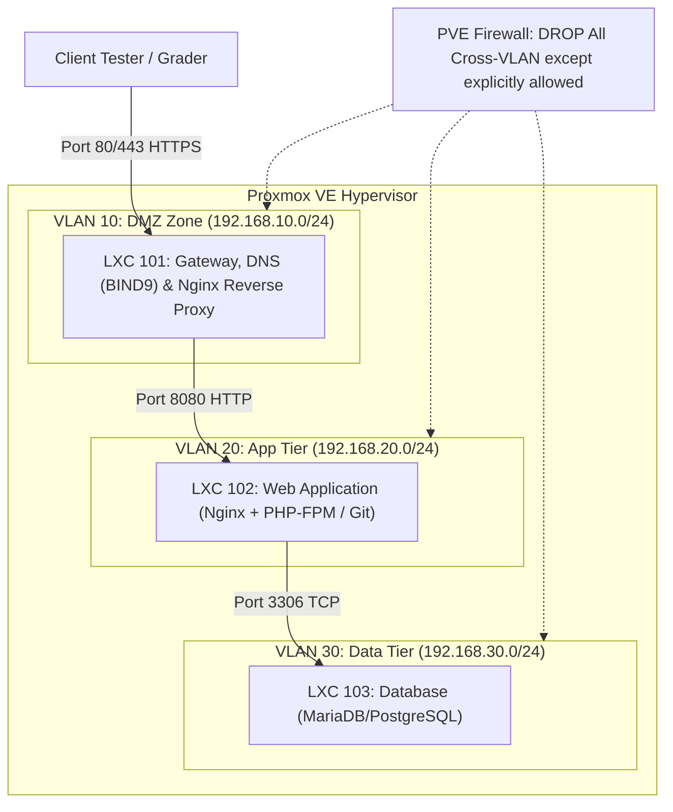

# Konsep & Mental Model Kisi-Kisi Lomba ITNSA (IT Network System Administration)

> **Catatan Filosofi Lomba**:  
> Di lomba ITNSA (LKS SMK / WorldSkills), **konfigurasi sintaks (IP, nama domain, nama user, port) akan selalu berbeda di setiap studi kasus**. Menghafal skrip konfigurasi baris-per-baris adalah kesalahan fatal. Kunci kemenangan seorang *system administrator* adalah memahami **prinsip kerja arsitektur (*under the hood*)**, **aliran paket data**, **alasan fungsional teknologi tersebut diujikan**, serta **bagaimana juri menguji sistem Anda secara otomatis**.

---

## Daftar Isi
1. [Mindset Juara & Cara Penilaian Juri LKS ITNSA](#1-mindset-juara--cara-penilaian-juri-lks-itnsa)
2. [Linux Dasar & Ubuntu 24.04 LTS (Noble Numbat)](#2-linux-dasar--ubuntu-2404-lts-noble-numbat)
3. [Domain Name System (DNS Server - BIND9)](#3-domain-name-system-dns-server---bind9)
4. [Git Dasar & Automated Deployment Workflow](#4-git-dasar--automated-deployment-workflow)
5. [Web Server (Nginx / Apache Architecture)](#5-web-server-nginx--apache-architecture)
6. [Reverse Proxy & Traffic Management](#6-reverse-proxy--traffic-management)
7. [SSL / TLS & Let's Encrypt (Certbot / Offline CA)](#7-ssl--tls--lets-encrypt-certbot--offline-ca)
8. [Proxmox VE: Arsitektur Virtualisasi & Data Center Tiering](#8-proxmox-ve-arsitektur-virtualisasi--data-center-tiering)
   - [LXC (Linux Containers)](#lxc-linux-containers)
   - [Firewall Multi-Level](#firewall-multi-level)
   - [User Management & RBAC Privilege](#user-management--rbac-privilege)
   - [Backup & Disaster Recovery (VZDump)](#backup--disaster-recovery-vzdump)
   - [VLAN Architecture di Hypervisor](#vlan-architecture-di-hypervisor)
9. [Bedah Skenario & Prediksi Varian Soal Lomba](#9-bedah-skenario--prediksi-varian-soal-lomba)
10. [Framework Problem Solving & Debugging Berbasis OSI Layer](#10-framework-problem-solving--debugging-berbasis-osi-layer)

---

## 1. Mindset Juara & Cara Penilaian Juri LKS ITNSA

Dalam kompetisi ITNSA, penilaian didasarkan pada empat pilar WorldSkills:

1. **Automated Verification (Black-Box Testing)**:  
   Juri jarang memeriksa file konfigurasi Anda secara manual. Mereka menggunakan script otomatis (seperti Python Testinfra, Ansible, Bash test suites) dari host juri. Script tersebut mengirimkan *probe*:
   - Apakah port terbuka?
   - Apakah DNS merespon query dalam <50ms?
   - Apakah header HTTP mengandung `X-Forwarded-For`?
   - Apakah status code mengembalikan 301 Redirect ke HTTPS?
2. **Service Persistence (Reboot Survival)**:  
   Sebelum penilaian akhir dimulai, juri akan mengeksekusi `reboot` pada server host dan seluruh container. Jika sebuah service tidak di-`enable` di systemd, atau konfigurasi network tidak persisten di file Netplan, skor untuk service tersebut bernilai **0**.
3. **Pemisahan Tugas & Segregasi (Isolation & Least Privilege)**:  
   Kenapa soal memisahkan service ke dalam beberapa container dan VLAN yang berbeda? Tujuannya adalah menguji pemahaman Anda tentang konsep **Defense-in-Depth**. Jika satu container web dieksploitasi, hacker tidak boleh langsung bisa melihat database atau host Proxmox.
4. **Idempotensi & Reproducibility**:  
   Setiap konfigurasi yang Anda buat harus bisa diulang dan stabil, bukan hasil manipulasi sementara di memory RAM.

---

## 2. Linux Dasar & Ubuntu 24.04 LTS (Noble Numbat)

### A. Konsep Fundamental & Cara Kerja *Under the Hood*
Ubuntu 24.04 LTS membawa perubahan arsitektur internal yang signifikan:
- **Netplan v2 Abstraction Layer**: Konfigurasi jaringan di Ubuntu bukan lagi berupa skrip ifupdown lawas (`/etc/network/interfaces`), melainkan deklarasi YAML yang di-render menjadi konfigurasi tingkat rendah untuk daemon backend: **systemd-networkd** (default di server) atau **NetworkManager** (default di desktop).
- **Systemd Init & Unit Lifecycle**: Systemd adalah process ID 1 (`PID 1`). Ia mengelola dependensi antar-service menggunakan target pohon graph. Menjalankan `systemctl start` hanya menyalakan service di sesi RAM saat ini; hanya `systemctl enable` yang membuat symlink ke `/etc/systemd/system/*.wants/` agar service hidup kembali pasca boot.
- **Security Defaults (AppArmor 4 & Restricted Namespaces)**: Ubuntu 24.04 memperketat izin eksekusi unprivileged user namespace, memengaruhi bagaimana container atau software tertentu (seperti sandbox aplikasi) dijalankan.
- **Systemd-resolved Stub Listener**: Secara default, Ubuntu 24.04 mengaktifkan resolver DNS caching internal yang mengikat (*bind*) IP `127.0.0.53` pada port 53.

### B. Peruntukan & Skenario di Lomba
1. **Pondasi Node**: Menjadi OS guest utama untuk semua LXC Container atau VM (Web, DNS, Database, Proxy).
2. **Uji Resolusi Dependensi**: Juri sengaja meminta service yang membutuhkan koneksi database. Jika service Anda start sebelum jaringan/database siap, service akan crash saat boot. Anda harus memahami parameter `After=network-online.target` dan `Restart=on-failure`.
3. **Manajemen Hak Akses & Sudoers**: Soal lomba biasanya melarang penggunaan login langsung sebagai user `root` via SSH, dan meminta pembuatan user kompetisi atau auditor yang hanya memiliki hak eksekusi sudo untuk perintah tertentu (least privilege).

### C. Titik Kritis & Jebakan Penilaian (Pitfalls)
- **Konflik Port 53 BIND9**: Saat memasang BIND9 di Ubuntu 24.04, instalasi sering gagal start karena port 53 sudah dipegang oleh `systemd-resolved`. Admin harus tahu cara mendisentralisasi DNS Stub Resolver tanpa merusak kemampuan resolving OS lokal.
- **Spasi Tab pada YAML Netplan**: Kesalahan satu karakter spasi atau penggunaan karakter Tab (`\t`) akan membuat parser Netplan error, yang menyebabkan antarmuka jaringan gagal diinisialisasi pasca-reboot.

---

## 3. Domain Name System (DNS Server - BIND9)

### A. Konsep Fundamental & Cara Kerja *Under the Hood*
DNS adalah database terdistribusi hierarkis berbentuk pohon (tree) terbalik:
- **Authoritative Nameserver vs Recursive Resolver**:
  - *Authoritative*: Memegang data resmi (*source of truth*) untuk sebuah zone domain (misal: mesin Anda bertanggung jawab penuh atas data `itnsa.id`).
  - *Recursive Resolver*: Mencari jawaban dari root nameserver (`.`), TLD (`.id`), hingga ke authoritative server, lalu menyimpannya dalam cache.
- **Forward Lookup vs Reverse Lookup**:
  - *Forward*: FQDN $\rightarrow$ IP Address (Record A untuk IPv4, AAAA untuk IPv6).
  - *Reverse*: IP Address $\rightarrow$ FQDN menggunakan domain semu `in-addr.arpa` (Record PTR). Reverse DNS sangat krusial di dunia enterprise untuk verifikasi anti-spoofing dan logging audit.
- **Anatomi Record DNS**:
  - `SOA` (Start of Authority): Menyimpan informasi zona, email admin, dan **Serial Number**. Jika serial number tidak dinaikkan, secondary DNS server tidak akan mereplikasi perubahan data.
  - `CNAME` (Canonical Name): Alias untuk nama domain lain. *Aturan penting*: Nama yang memiliki CNAME tidak boleh memiliki record lain (seperti MX atau TXT).
  - `Forwarders`: Jika server diminta mencari domain di luar zone miliknya (misal `google.com`), query akan diteruskan ke IP upstream (seperti `8.8.8.8`).

### B. Peruntukan & Skenario di Lomba
1. **Tulang Punggung Infrastruktur (Backbone)**:
   Di lomba ITNSA, DNS adalah komponen pertama yang wajib berjalan sempurna. Seluruh konfigurasi berikutnya (Nginx VirtualHost, Reverse Proxy upstream, Git clone remote, SSL certificate verification) bergantung pada nama domain.
2. **Kemandirian Jaringan (Offline Resilience)**:
   Sering kali lomba diadakan di lingkungan intranet terisolasi. DNS internal bertugas menjamin semua node dapat saling berkomunikasi tanpa bergantung pada koneksi internet luar.
3. **Efek Domino Nilai**:
   Jika DNS Anda bermasalah, script penilaian otomatis juri yang memanggil `curl http://app.itnsa.id` akan langsung *timeout* pada tahap lookup, mengakibatkan nilai modul Web Server dan SSL ikut jatuh menjadi 0 meskipun konfigurasi Nginx Anda sempurna.

### C. Titik Kritis & Jebakan Penilaian (Pitfalls)
- **Trailing Dot (`.`)**:
  Di BIND9, lupa menuliskan tanda titik di akhir FQDN (contoh: menulis `web.itnsa.id` alih-alih `web.itnsa.id.`) akan membuat BIND9 otomatis menganggap itu subdomain relatif, menghasilkan nama konyol seperti `web.itnsa.id.itnsa.id.`
- **DNSSEC Validation di Jaringan Offline**:
  Secara default BIND9 mengaktifkan `dnssec-validation auto`. Jika server berada di lab tertutup tanpa akses ke root keys internet, resolving domain lokal sering kali gagal dengan status `SERVFAIL`. Menonaktifkan validasi DNSSEC atau mengonfigurasi trust anchor internal adalah trik wajib di lingkungan offline.

---

## 4. Git Dasar & Automated Deployment Workflow

### A. Konsep Fundamental & Cara Kerja *Under the Hood*
Git bukan sekadar alat backup folder, melainkan sebuah Directed Acyclic Graph (DAG) dari snapshot konten:
- **Tiga State Git**:
  1. *Working Directory*: File nyata di disk yang sedang diedit.
  2. *Staging Area (Index)*: Buffer persiapan snapshot berikutnya.
  3. *Repository (.git)*: Database objek terkompresi (Blob, Tree, Commit) yang tidak dapat diubah (*immutable*).
- **Branching & Detached HEAD**:
  Branch hanyalah sebuah pointer (referensi teks ringan) yang menunjuk ke commit hash tertentu. Jika berpindah ke commit tanpa nama branch, Anda masuk ke kondisi *Detached HEAD* di mana perubahan baru tidak terikat ke branch mana pun.
- **Git Hooks**:
  Skrip lifecycle yang dieksekusi secara otomatis saat event tertentu terjadi (misal: `pre-commit`, `post-commit`, `post-receive`).

### B. Peruntukan & Skenario di Lomba
1. **Distribusi Source Code Aplikasi**:
   Juri tidak lagi menyalin folder aplikasi lewat USB. Mereka menyediakan repositori git lokal (GitLab/Gitea/Bare repo) dan Anda diinstruksikan untuk menarik (*fetch/clone*) kode dari branch atau tag rilis tertentu (misal: branch `production`, tag `v1.2`).
2. **Simulasi GitOps & Auto-Deployment**:
   Soal lomba sering menguji pembuatan *deployment pipeline* mini: saat developer melakukan `git push` ke server, skrip hook `post-receive` di server otomatis menduplikasi file kerja ke direktori web (`/var/www/html`), mengatur hak akses user `www-data`, dan me-reload web server tanpa intervensi manual.
3. **Audit Jejak Konfigurasi**:
   Terkadang peserta diminta menginisialisasi repository git pada folder konfigurasi `/etc/` untuk merekam riwayat perubahan yang dilakukan selama kompetisi.

### C. Titik Kritis & Jebakan Penilaian (Pitfalls)
- **Eksposur Folder `.git` ke Publik**:
  Jika Anda melakukan clone langsung ke root direktori web server dan tidak memblokir akses ke `/.git`, siapa pun di jaringan bisa mengunduh seluruh source code dan riwayat commit. Juri sering menyisipkan *security audit check* untuk melihat apakah `http://domain.id/.git/HEAD` menghasilkan 403 Forbidden.
- **Ownership Conflict (`root` vs `www-data`)**:
  Menjalankan perintah `git pull` atau `git clone` menggunakan akun `root` akan membuat file web berpemilik `root:root`. Akibatnya, aplikasi web (PHP/NodeJS) gagal menulis file log atau mengunggah media karena tidak punya izin tulis.

---

## 5. Web Server (Nginx / Apache Architecture)

### A. Konsep Fundamental & Cara Kerja *Under the Hood*
Web server bertugas menerima koneksi socket TCP layer 4, mem-parsing protokol HTTP layer 7, dan mengembalikan payload data (HTML, JSON, asset biner):
- **Event-Driven Non-Blocking (Nginx) vs Process/Thread-Based (Apache)**:
  - Nginx menggunakan satu master process dan beberapa *worker processes*. Setiap worker menangani ribuan koneksi secara asinkron menggunakan system call kernel (`epoll` di Linux). Ini membuatnya sangat hemat RAM dan tahan terhadap lonjakan traffic.
  - Apache (dengan MPM Event/Worker) menggunakan pool proses dan thread untuk mengeksekusi request.
- **Mekanisme Virtual Hosting (Server Blocks)**:
  Satu server fisik dengan satu alamat IP dapat melayani puluhan website berbeda. Web server membedakannya dengan membaca **HTTP Header `Host`** yang dikirimkan oleh browser klien.
- **Logika Lokasi & Resolusi File**:
  Directive `root` menggabungkan URI request ke path folder di harddisk (`root /var/www; location /app` $\rightarrow$ `/var/www/app`). Sedangkan `alias` mengganti seluruh path yang cocok.
- **FastCGI Protocol**:
  Web server tidak bisa mengeksekusi bahasa pemrograman seperti PHP secara langsung. Nginx meneruskan request dinamis ke interpreter terpisah (seperti PHP-FPM) melalui protokol biner FastCGI via Unix Socket (`/run/php/...sock`) atau TCP port (`127.0.0.1:9000`).

### B. Peruntukan & Skenario di Lomba
1. **Serving Production Assets**: Menghosting landing page, REST API, atau aplikasi kompetisi.
2. **Kustomisasi Respon & Branding**: Mengonfigurasi halaman error khusus (404 Not Found, 502 Bad Gateway) agar tidak membocorkan versi web server (Information Disclosure prevention).
3. **Restriksi & Hardening**: Menonaktifkan directory listing (`autoindex off`), menyembunyikan banner versi server (`server_tokens off`), dan membatasi method HTTP (hanya GET, POST, HEAD).

### C. Titik Kritis & Jebakan Penilaian (Pitfalls)
- **Konflik `default_server`**:
  Jika request datang tanpa header Host yang cocok, Nginx akan melemparnya ke server block pertama yang dibaca atau yang memiliki flag `default_server`. Ketidaktahuan tentang prioritas ini bisa membuat domain A menampilkan website domain B.
- **Socket Permissions**:
  PHP-FPM socket harus memiliki permission yang mengizinkan user web server (`www-data`) untuk membaca dan menulis socket tersebut. Jika mismatch, Nginx akan langsung memunculkan pesan `502 Bad Gateway`.

---

## 6. Reverse Proxy & Traffic Management

### A. Konsep Fundamental & Cara Kerja *Under the Hood*
Reverse proxy berdiri di depan satu atau beberapa backend server, bertindak sebagai gerbang tunggal yang menerima request dari internet publik:

```
[Klien Luar] 
      │
      ▼ (Port 80 / 443 Publik)
[Reverse Proxy di DMZ] 
      │ 
      ├─ Mengganti IP Sumber menjadi IP Proxy
      ├─ Menyisipkan Header X-Forwarded-*
      ├─ Menghentikan Enkripsi SSL (SSL Termination)
      │
      ▼ (Port 8080 Internal Tanpa Enkripsi)
[Backend Server di Subnet Privat]
```

- **Alasan Pemisahan Arsitektur (DMZ Segregation)**:
  Backend server (aplikasi bisnis, basis data) tidak boleh diberi IP publik atau akses langsung ke internet demi meminimalisir permukaan serangan (*attack surface*). Reverse proxy berada di zona semi-terbuka (DMZ) untuk menyaring traffic.
- **Masalah Header & IP Klien**:
  Secara teknis, ketika reverse proxy meneruskan paket ke backend, backend melihat koneksi TCP tersebut datang dari IP reverse proxy, bukan dari klien asli. Oleh karena itu, reverse proxy wajib merekonstruksi header HTTP:
  - `X-Real-IP`: IP asli browser klien.
  - `X-Forwarded-For`: Daftar rantai IP yang dilalui paket.
  - `X-Forwarded-Proto`: Memberi tahu backend apakah klien awal menggunakan protokol HTTP atau HTTPS.
- **Load Balancing Algorithm**:
  - *Round Robin*: Membagi beban berurutan secara merata.
  - *Least Connections*: Mengarahkan request ke backend yang sedang memiliki koneksi aktif paling sedikit.
  - *IP Hash*: Menjamin klien dengan IP yang sama akan selalu diarahkan ke backend yang sama (membantu mempertahankan *session state* tanpa Redis/memcached).

### B. Peruntukan & Skenario di Lomba
1. **SSL Offloading / Termination**:
   Beban komputasi berat untuk mengenkripsi/mendekripsi TLS ditangani sepenuhnya oleh Reverse Proxy. Backend cukup melayani HTTP biasa di jaringan privat yang aman, menghemat CPU backend.
2. **Path-Based Routing**:
   Routing traffic berdasarkan URL: misal `itnsa.id/api` dialihkan ke LXC Microservice Python, sedangkan `itnsa.id/` dialihkan ke LXC PHP.
3. **High Availability Simulation**:
   Juri menguji ketahanan sistem dengan mematikan salah satu node backend. Reverse proxy harus otomatis mengalihkan seluruh traffic ke node cadangan tanpa memunculkan error pada layar pengguna (*passive health check*).

### C. Titik Kritis & Jebakan Penilaian (Pitfalls)
- **Infinite Redirect Loop**:
  Jika reverse proxy mengarahkan HTTPS ke backend HTTP, dan aplikasi di backend memiliki konfigurasi "Force HTTPS", backend akan terus melempar redirect 301 kembali ke proxy karena mengira klien mengaksesnya lewat HTTP biasa. Solusinya: Teruskan header `X-Forwarded-Proto https;` dan `proxy_set_header Host $host;`.
- **Buffer & Gateway Timeout (504)**:
  Jika aplikasi backend memerlukan waktu proses data lebih lama dari batas waktu proxy (`proxy_read_timeout`), Nginx proxy akan memutuskan koneksi secara sepihak dan melempar error 504.

---

## 7. SSL / TLS & Let's Encrypt (Certbot / Offline CA)

### A. Konsep Fundamental & Cara Kerja *Under the Hood*
Protokol TLS (Transport Layer Security) menyediakan tiga pilar keamanan: **Kerahasiaan** (Enkripsi simetris data), **Integritas** (HMAC/AEAD mencegah data dimanipulasi di tengah jalan), dan **Otentikasi** (Verifikasi identitas server menggunakan sertifikat digital):
- **Public Key Infrastructure (PKI) & Chain of Trust**:
  Browser klien memiliki daftar sertifikat Root CA bawaan yang dipercaya. Server Anda tidak diverifikasi langsung oleh Root CA, melainkan oleh Intermediate CA yang ditandatangani oleh Root CA. Jika rantai sertifikat (*certificate chain*) tidak lengkap di server Anda, browser akan menampilkan peringatan keamanan (*Untrusted Issuer*).
- **Protokol ACME (Automated Certificate Management Environment)**:
  Let's Encrypt bekerja tanpa intervensi manusia menggunakan agen otomatis (Certbot) melalui protokol ACME:
  - **HTTP-01 Challenge**: Server ACME meminta Certbot membuat file token acak di path `http://<domain>/.well-known/acme-challenge/<token>`. Server ACME akan melakukan curl ke URL tersebut via internet. Jika cocok, sertifikat diterbitkan.
  - **DNS-01 Challenge**: Certbot membuat record DNS tipe `TXT` dengan nama `_acme-challenge.<domain>`. Berguna untuk mendapatkan sertifikat *Wildcard* (`*.itnsa.id`) atau server yang tidak memiliki port 80 publik.
- **HSTS (HTTP Strict Transport Security)**:
  Header respons HTTP yang memerintahkan browser agar **selamanya** berkomunikasi hanya menggunakan HTTPS, mencegah serangan *SSL Striping / Man-In-The-Middle*.

### B. Peruntukan & Skenario di Lomba
1. **Kepatuhan Protokol Modern**: Mengubah seluruh interaksi web dari port 80 (plaintext) ke port 443 (encrypted) dengan auto-redirect 301 Permanen.
2. **Kondisi Lab Online vs Offline**:
   - *Jika Online*: Menggunakan Certbot resmi Let's Encrypt.
   - *Jika Offline (Kasus Klasik LKS)*: Juri menyiapkan simulasi internet menggunakan server ACME lokal (misal **Pebble** atau **Smallstep Step-CA**), atau menyediakan file Root CA internal. Peserta dituntut mampu:
     - Mengarahkan Certbot ke endpoint ACME Directory lokal menggunakan flag `--server https://...`
     - Mengimpor Root CA juri ke trust store OS (`/usr/local/share/ca-certificates/` lalu `update-ca-certificates`) agar curl/testing script tidak melempar error validasi SSL.

### C. Titik Kritis & Jebakan Penilaian (Pitfalls)
- **Path Challenge Terhalang Proxy**:
  Saat menggunakan HTTP-01 challenge pada server Reverse Proxy, pastikan path `/.well-known/acme-challenge/` tidak dialihkan ke backend sebelum Certbot selesai memvalidasi token.
- **Menggunakan `cert.pem` alih-alih `fullchain.pem`**:
  Pada konfigurasi Nginx, mengisi directive `ssl_certificate` dengan `cert.pem` (hanya sertifikat server tanpa intermediate CA) akan menyebabkan script tester otomatis menganggap SSL Anda invalid (*Incomplete Certificate Chain*). Selalu gunakan `fullchain.pem`.

---

## 8. Proxmox VE: Arsitektur Virtualisasi & Data Center Tiering

Proxmox Virtual Environment (PVE) adalah hypervisor Type-1 berbasis Debian. Di lomba ITNSA, Proxmox adalah kanvas utama tempat seluruh arsitektur jaringan dibangun.

---

### LXC (Linux Containers)
- **Konsep *Under the Hood***:
  Berbeda dari KVM/QEMU yang memvirtualisasikan perangkat keras fisik (BIOS, CPU virtual, NIC emulasi) secara penuh, LXC adalah **virtualisasi tingkat kernel**. Container menggunakan kernel Linux milik host Proxmox secara bersamaan, diisolasi menggunakan dua fitur utama kernel Linux:
  - *cgroups (Control Groups)*: Membatasi penggunaan resource (RAM, CPU, I/O disk).
  - *namespaces*: Mengisolasi pandangan container terhadap process tree (`pid`), antarmuka jaringan (`net`), mount point storage (`mnt`), dan user ID (`user`).
- **Unprivileged vs Privileged Container**:
  - *Unprivileged Container (Default & Rekomendasi Keamanan)*: UID 0 (root) di dalam container di-mapping ke UID non-root (misal UID 100000) di host Proxmox. Jika penyerang berhasil membobol root container, mereka tetap hanya user biasa tanpa hak istimewa di host Proxmox.
  - *Privileged Container*: UID 0 di dalam container setara dengan UID 0 di host. Hanya digunakan jika container membutuhkan akses langsung ke hardware host atau mount NFS/SMB tertentu.
- **Peran di Lomba**:
  LXC digunakan untuk menghemat resource RAM dan CPU pada PC pengujian lomba. Container dapat di-*provisioning* dan di-*boot* dalam hitungan 2–5 detik, memungkinkan pengujian multi-server di hardware terbatas.

---

### Firewall Multi-Level
- **Konsep *Under the Hood***:
  Proxmox Firewall bekerja di atas kernel Netfilter/iptables dan ipset dengan struktur **pewarisan tiga lapis (Hierarchical Inheritance)**:
  1. *Datacenter Level*: Aturan makro yang berlaku untuk seluruh node cluster dan semua guest VM/CT.
  2. *Node Level*: Aturan yang melindungi host fisik Proxmox itu sendiri (misal port Web GUI 8006, port cluster corosync 5405).
  3. *Guest (VM/CT) Level*: Aturan mikrosegmentasi yang terikat pada virtual network interface masing-masing container.
- **Logika Default Policy (Zero-Trust)**:
  Standar pengujian keamanan ITNSA mengharuskan penerapan kebijakan default: **Incoming DROP, Outgoing ACCEPT**. Seluruh port masuk tertutup kecuali port layanan yang secara eksplisit diminta dibuka oleh soal (misal port 80, 443, dan 22 dari IP manajemen).
- **Jebakan Fatal**:
  Mengaktifkan Firewall di level Datacenter dengan policy incoming DROP sebelum membuat whitelist untuk port 8006 (Web GUI) dan port 22 (SSH) akan **mengunci admin keluar dari server secara permanen (Lockout)**!

---

### User Management & RBAC Privilege
- **Konsep *Under the Hood***:
  Proxmox memisahkan otentikasi identitas dan otorisasi wewenang:
  - **Authentication Realms**:
    - `pam` (Linux PAM): User yang terdaftar di OS Linux host (`/etc/passwd`).
    - `pve` (Proxmox VE Authentication): User internal yang disimpan di database cluster `/etc/pve/user.cfg`.
  - **Role-Based Access Control (RBAC)**:
    Hak akses dibentuk dari kombinasi tiga elemen:  
    $$\text{Privilege} \longrightarrow \text{Role} \longrightarrow \text{Path (Objek)}$$
    - *Path*: Hirarki resource Proxmox, seperti `/` (seluruh datacenter), `/vms` (semua VM/CT), `/vms/101` (hanya CT 101), atau `/storage/local-lvm`.
    - *Role*: Kumpulan hak istimewa (misal `PVEAuditor` hanya bisa membaca/melihat status, `PVEVMAdmin` bisa mengatur siklus hidup VM).
- **Peran di Lomba**:
  Soal lomba sering meminta pembuatan akun khusus juri atau tim pemantau (misal: user `auditor@pve` dengan role `PVEAuditor` yang hanya diizinkan melihat VM di Resource Pool tertentu tanpa izin mematikan atau mengedit konfigurasi).

---

### Backup & Disaster Recovery (VZDump)
- **Konsep *Under the Hood***:
  Utility `vzdump` membuat arsip terkompresi dari filesystem container:
  - *Snapshot Mode*: Mengambil backup saat container sedang berjalan tanpa downtime. Data konsisten diambil menggunakan mekanisme write-barrier / copy-on-write.
  - *Stop Mode*: Mematikan container sementara, membuat tarball backup, lalu menyalakan kembali. Menghasilkan konsistensi data 100% untuk database bertransaksi tinggi, namun menimbulkan downtime.
  - *Retention / Pruning Policy*: Logika pembersihan backup otomatis (misal: `keep-last=3` hanya menyimpan 3 snapshot terakhir dan otomatis menghapus snapshot ke-4 untuk mencegah disk penuh).
- **Peran di Lomba**:
  Menguji kemampuan merancang skenario pemulihan bencana (*Disaster Recovery*). Juri mungkin sengaja merusak salah satu container di akhir sesi dan meminta Anda me-restore service dari file backup terjadwal.

---

### VLAN Architecture di Hypervisor
- **Konsep *Under the Hood***:
  VLAN (IEEE 802.1Q) menyisipkan 4-byte VLAN Tag pada Ethernet frame untuk memisahkan domain broadcast fisik menjadi beberapa domain broadcast logis (VLAN ID 1–4094):
  - **Linux Bridge Standar vs VLAN-Aware Bridge**:
    Secara default, bridge `vmbr0` di Linux bertindak seperti switch unmanaged bodoh yang membuang atau meneruskan paket tanpa memproses tag. Dengan mengaktifkan `bridge-vlan-aware yes`, `vmbr0` berubah menjadi **Virtual Switch Layer 2 yang mendukung 802.1Q Trunking**.
  - **Access Port pada LXC**:
    Saat antarmuka virtual container (`veth`) diberi tag (misal `tag=10`), Proxmox secara otomatis memasukkan port tersebut sebagai *Access Port* di VLAN 10. Frame yang keluar dari container akan di-tag dengan ID 10, dan frame yang masuk ke container akan dilepas (*untagged*) tag-nya sehingga container tidak perlu tahu menahu tentang konfigurasi VLAN di level OS-nya.
- **Peran di Lomba**:
  Membuat segmentasi jaringan:
  - `VLAN 10`: DMZ (Public Facing - DNS, Reverse Proxy).
  - `VLAN 20`: Application / Middleware.
  - `VLAN 30`: Database / Storage Internal.
  - `VLAN 99`: Management (Proxmox Web GUI & Out-of-band SSH).
  Container di VLAN 10 tidak boleh bisa berkomunikasi langsung ke VLAN 30 tanpa melewati router/firewall pengendali.

---

## 9. Bedah Skenario & Prediksi Varian Soal Lomba

Berikut tiga pola variasi studi kasus yang paling sering dirilis di LKS ITNSA tingkat Daerah, Nasional, maupun Invitational:



---

### Varian 1: "The Secure Multi-Tier Enterprise Delivery" (Format Standar)
- **Karakteristik Soal**:
  Fokus pada isolasi VLAN dan pemisahan fungsi node.
- **Alur Kerja Pengujian Juri**:
  1. Juri mengakses domain publik `https://portal.lomba.id`.
  2. DNS lokal harus merespon alamat IP DMZ.
  3. Reverse Proxy di DMZ menerima koneksi, melakukan terminasi SSL, lalu meneruskan request ke container Web di VLAN internal.
  4. Container Web mengambil data dari container Database di VLAN Data.
  5. Juri melakukan penetrasi / scanning dari DMZ ke VLAN Database; koneksi **wajib gagal** karena diblokir oleh Proxmox Firewall.

### Varian 2: "The Automated GitOps & Continuous Deployment" (Format Modern)
- **Karakteristik Soal**:
  Fokus pada siklus hidup aplikasi dan integrasi Git.
- **Alur Kerja Pengujian Juri**:
  1. Juri melakukan clone dari repository Git di server, mengubah file teks halaman web, lalu melakukan `git push origin release`.
  2. Git Hook di server harus otomatis memicu deployment ke direktori web tanpa peserta menyentuh keyboard.
  3. Reverse Proxy harus langsung menyajikan perubahan tersebut melalui HTTPS dengan sertifikat yang valid.
  4. Seluruh service harus memiliki backup terjadwal yang otomatis terkompresi di storage target.

### Varian 3: "The Offline Disaster Recovery & System Auditing" (Format Hardening)
- **Karakteristik Soal**:
  Lab diisolasi total tanpa internet. Peserta diberikan sertifikat Root CA buatan juri.
- **Alur Kerja Pengujian Juri**:
  1. Peserta harus mengimpor Root CA ke seluruh container dan mengonfigurasi Certbot / Web Server agar sertifikat lokal dipercaya sistem.
  2. Juri membuat user penilaian pada Proxmox (`grader@pve`) yang harus memiliki hak akses auditor saja.
  3. Juri sengaja menghapus salah satu container, lalu meminta peserta me-restore container tersebut dari arsip `vzdump` dalam waktu maksimal 10 menit dengan IP dan konfigurasi yang persis sama.
  4. Server di-reboot total untuk menguji apakah seluruh service kembali berjalan normal.

---

## 10. Framework Problem Solving & Debugging Berbasis OSI Layer

Ketika sebuah service gagal bekerja di saat lomba, **jangan panik dan jangan mengubah file konfigurasi secara acak**. Gunakan metode eliminasi lapis demi lapis dari bawah ke atas (Bottom-Up Troubleshooting):

| Layer OSI | Objek yang Diperiksa | Pertanyaan Diagnostik | Tool CLI Diagnostik |
|---|---|---|---|
| **Layer 1-2 (Physical/Data Link)** | Bridge, VLAN Tagging, Veth interface | Apakah status antarmuka `UP`? Apakah VLAN-aware aktif di bridge? Apakah ID tag sudah sesuai? | `ip link show`, `bridge vlan show` |
| **Layer 3 (Network)** | IP Address, Netmask, Routing Table, Gateway | Apakah IP address terpasang? Apakah ada rute default? Apakah bisa ping ke gateway? | `ip addr show`, `ip route show`, `ping -c 2 <gw>` |
| **Layer 4 (Transport)** | TCP/UDP Port, Firewall Rules, Socket Listening | Apakah port service sedang *LISTEN*? Apakah paket diblokir oleh Firewall Proxmox atau UFW? | `ss -tulpn`, `iptables -L -n -v`, `pve-firewall status` |
| **Layer 7 (Application)** | Nginx config, BIND9 zones, PHP-FPM, SSL certs | Apakah sintaks konfigurasi valid? Mengapa service crash saat start? Apa kata log error? | `nginx -t`, `named-checkconf`, `journalctl -u <svc> -e` |
| **Integrasi Client** | DNS Lookup, HTTP Response Code, SSL Handshake | Apakah DNS resolver mengembalikan IP yang benar? Apakah ada error 502/404? Apakah SSL handshake sukses? | `dig @<ip> <domain>`, `curl -Iv https://<domain>`, `openssl s_client -connect ...` |

---

> **Aturan Emas Terakhir Menjelang Sesi Berakhir**:  
> Luangkan **20 menit sebelum waktu lomba habis** untuk melakukan **simulasi reboot total**.  
> Jalankan `reboot` pada host utama Proxmox. Tunggu hingga semua node menyala kembali, lalu lakukan verifikasi akhir dari sisi klien. Jika ada service yang mati pasca-reboot, perbaiki segera status `systemctl enable` atau file jaringan Netplan Anda!
